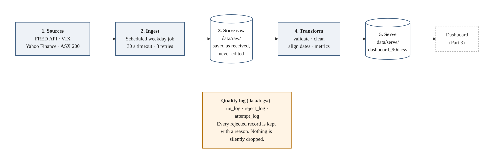

# Really Big Bank – Market Intelligence Pipeline (Proof of Concept)

BUSA3022 Assessment 2. This repository holds the proof-of-concept code behind the Analytics Implementation Plan.
It is a thin, working slice of the plan, not a production system.

| Part | What the code proves | File |
| --- | --- | --- |
| Part 1 Data pipeline | Both sources ingest end to end, raw data is kept untouched, timeouts are retried, and **no record is silently dropped** | `src/pipeline.py` |
| Part 2 Data curation | The two sources line up on one Sydney trading-day axis, and both metrics calculate correctly (checked by hand) | `src/metrics.py` |
| Tests | Known bad rows, a simulated timeout and a hand-calculated metric check | `tests/test_pipeline.py` |
| Walkthrough | Runs everything step by step in Google Colab | `BUSA3022_PoC.ipynb` |

## Sources

| Role | Source | Series | Time zone |
| --- | --- | --- | --- |
| Macro | FRED API | CBOE Volatility Index (VIXCLS) | US Eastern |
| Market index | Yahoo Finance via `yfinance` | S&P/ASX 200 (^AXJO) | Australia/Sydney |

## Pipeline layers



## For the Part 2 owner (data curation)

You don't need to touch Part 1. Once the pipeline has run once, the cleaned data is already in this repo:

| File | What it holds |
| --- | --- |
| `data/clean/vix_daily.csv` | One row per US date: `date`, `vix_close` |
| `data/clean/asx_daily.csv` | One row per ASX trading day: `date`, `asx_close`, `asx_volume` |

Your code lives in `src/metrics.py`. It joins the two files on one Sydney trading-day axis, calculates the metrics
and writes `data/clean/market_daily.csv` and `data/serve/dashboard_90d.csv` (the table Part 3 reads).

To run only Part 2 in Colab, open `BUSA3022_PoC.ipynb`, run section 1 (setup), skip sections 2 to 4, then run section 5.
No FRED key is needed for section 5.

The plain-language metric definitions are at the top of `metrics.py`. They are a starting draft. Review them, change
the windows or metrics if you choose different ones, and keep the definition in your report as the brief requires.
Run `pytest -q` after any change. The test `test_metrics_match_hand_calculation` will catch a calculation that drifts.

## How to run it (Google Colab, nothing to install locally)

1. Get a free FRED API key at https://fred.stlouisfed.org/docs/api/api_key.html
2. Open `BUSA3022_PoC.ipynb` in Colab (File > Open notebook > GitHub, paste this repo's URL).
3. Click the key icon in Colab's left sidebar, add a secret named `FRED_API_KEY`, and switch on notebook access.
4. Run the cells from top to bottom.

To run on your own computer instead:

```bash
pip install -r requirements.txt
export FRED_API_KEY=your_key_here
python src/pipeline.py      # Part 1: ingest, validate, log
python src/metrics.py       # Part 2: align, calculate, build the dashboard table
pytest -q                   # tests, no internet needed
```

## Quality rules (checked in this order)

| Rule | Meaning | Action |
| --- | --- | --- |
| `invalid_date` | Date missing or not a real date | Rejected and logged |
| `non_numeric_value` | Value blank or text, e.g. FRED's `.` for a missing day | Rejected and logged |
| `non_positive_value` | ASX close or volume is zero or below | Rejected and logged |
| `duplicate_date` | Same date twice in one batch | Rejected and logged |
| `already_loaded` | Date already in the clean layer (expected, because each run re-requests about ten trading days) | Counted in the run log, not re-loaded |

Every run must satisfy `rows_in = rows_passed + rows_already_loaded + rows_rejected`. If it doesn't, the run stops with an error.

## Failure scenario: API timeout

A request taking longer than 30 seconds, or returning an error, is retried three times after 1, 2 and 4 minutes.
If every attempt fails, the last good load is kept, `data/clean/STALE.txt` is written so the dashboard can show
a "data as at" warning, the run is logged as `failed_kept_last_good`, and the script exits with an error.
On GitHub Actions a failed run emails the repository owner, which acts as the alert.

## Re-running a failed day

Just run `python src/pipeline.py` again. Each run re-requests about ten trading days, so a missed day is picked up
automatically and nothing is duplicated. To reload a longer period, call `pipeline.run(key, start=date(2026, 6, 1))`.

## Standards for contributors (including AI-generated code)

- Files are named `source_series_YYYYMMDDTHHMMSS`. Columns use `snake_case` with the unit in the name where useful (`volatility_14d_pct`).
- Raw files are never edited or deleted.
- Every change goes through a pull request, a reviewer, and a passing `pytest` run.
- Code drafted by an AI agent is marked "AI-assisted" in the commit message and checked against a few rows worked by hand before it is merged.
